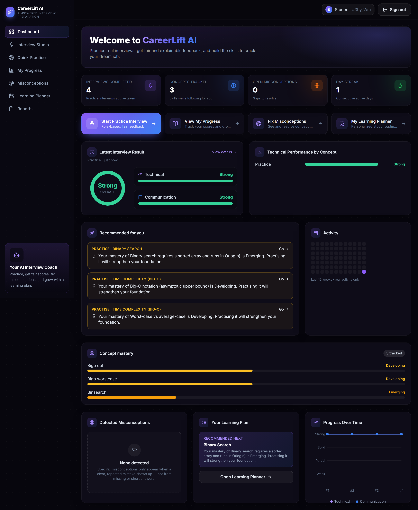

# CareerLift AI — Article Assets

All diagrams are original SVGs in `docs/article/images/`. Created for this article; no external images or ScholarMatch assets used.

## Diagrams

| File | Title | Used in Article | Description |
|---|---|---|---|
| `docs/article/images/01-system-architecture.svg` | Overall System Architecture | ✅ Section: Introduction + System Architecture | Full stack: React → Nginx → FastAPI → Strands → Bedrock + all 5 phase boxes + AWS infra row + verified stats |
| `docs/article/images/02-fairscore-pipeline.svg` | FairScore Dual-Axis Pipeline | ✅ Section: Technical implementation | PII gate → Strands graph (evaluate + verifier) + independent comm coach → Python scorer → ScoreResult |
| `docs/article/images/03-coding-arena.svg` | Secure Coding Arena Architecture | ✅ Section: Phase 2 | Docker isolation controls (network, filesystem, resources, identity), all 4 cells with verified results |
| `docs/article/images/04-aws-deployment.svg` | AWS Production Architecture | ✅ Section: AWS integration | EC2 boundary, Nginx, FastAPI, Docker, SQLite/EBS, Let's Encrypt, all AWS services, SG rules |
| `docs/article/images/05-five-phases.svg` | Five Learning Phases | ✅ Section: Five phases | Hub-and-spoke: Phase 0 centre, Phases 1–4 as spokes, arrows to dashboard/recommendations |
| `docs/article/images/06-fairness-concept.svg` | Fairness Gap Concept | ✅ Section: Social impact | Side-by-side: same content in plain vs advanced English, baseline gap vs CareerLift target |

## Screenshots

Application screenshots are available in `frontend/screenshots/` from the automated Playwright harness. Key ones for the article:

| File | Shows |
|---|---|
| `frontend/screenshots/03-dashboard.png` | Dashboard with real stat cards, mastery, recommendations |
| `frontend/screenshots/14-assessment-attempt.png` | Assessment interface in progress |
| `frontend/screenshots/15-assessment-result.png` | Results page with per-category breakdown |
| `frontend/screenshots/18-sysdesign-workspace.png` | System Design canvas with components + decisions |
| `frontend/screenshots/19-sysdesign-result.png` | System Design results — grade A, all dimensions |

To embed a screenshot in the article (if Builder Center supports it):
```markdown

```

## Video

`results/demo.webm` — 34 seconds, valid WebM, produced by `ss video` in mock mode.
Three scenes: plain-English answer (Strong/Strong), advanced-English same content (Strong/Strong), PII blocked (input gate).
**Must be uploaded to YouTube/Vimeo and the link added to ARTICLE.md before submission.**
